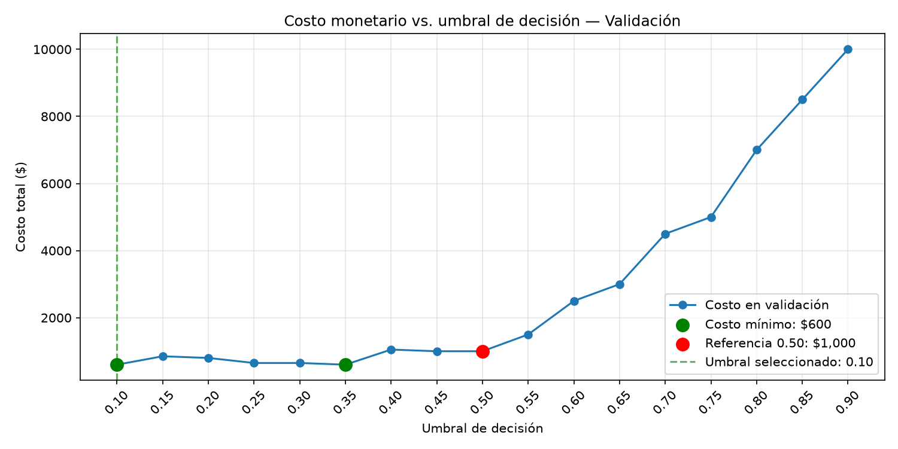

# Práctica 1 - Machine Learning

## Descripción del proyecto

Proyecto de Machine Learning desarrollado como parte de la Práctica 1.

El objetivo es analizar un conjunto de datos de lecturas de sensores,
realizar un proceso de exploración y preprocesamiento, entrenar modelos
de aprendizaje supervisado y no supervisado, comparar su desempeño y
analizar la latencia de inferencia.

Se utilizaron modelos de clasificación supervisada y algoritmos de
clustering para identificar patrones presentes en las lecturas de los
sensores.

## Estructura del repositorio

```text
ml-practica1-pesantez/
│
├── data/
│   ├── raw/
│   └── processed/
│
├── models/
│   ├── random_forest.pkl
│   ├── svm.pkl
│   ├── kmeans.pkl
│   └── dbscan.pkl
│
├── notebooks/
│   ├── 01_eda.ipynb
│   ├── 02_supervised.ipynb
│   └── 03_unsupervised.ipynb
│
├── src/
│   ├── data_loader.py
│   ├── train_supervised.py
│   └── train_unsupervised.py
│
├── benchmark_latency.json
├── requirements.txt
└── README.md

## Instalación y ejecución

### 1. Crear y activar el entorno virtual

```bash
python -m venv venv
```

### 2. Activar el entorno virtual

En Windows PowerShell:

```powershell
.\venv\Scripts\Activate.ps1
```

### 3. Instalar las dependencias

```bash
pip install -r requirements.txt
```

### 4. Ejecutar el modelo supervisado

Desde la carpeta raíz del proyecto:

```bash
python src/train_supervised.py
```

Este script:

- Carga el dataset original.
- Separa las variables de entrada y la variable objetivo.
- Divide los datos en entrenamiento y prueba.
- Aplica `RobustScaler`.
- Entrena un modelo Random Forest.
- Entrena un modelo SVM.
- Calcula Accuracy, F1-score y matriz de confusión.
- Compara el tiempo de entrenamiento de ambos modelos.
- Guarda los modelos entrenados en la carpeta `models/`.

### 5. Ejecutar los modelos no supervisados

```bash
python src/train_unsupervised.py
```

Este script:

- Carga los datos procesados.
- Utiliza las 24 variables de los sensores.
- Determina el número de clusters para K-Means mediante el método del codo.
- Entrena K-Means.
- Evalúa el agrupamiento mediante Silhouette Score.
- Entrena DBSCAN.
- Prueba diferentes valores de `eps`.
- Analiza el número de clusters y puntos considerados como ruido.
- Utiliza PCA para visualizar los clusters.
- Guarda los modelos entrenados en la carpeta `models/`.

### 6. Notebooks

La carpeta `notebooks/` contiene los análisis realizados durante la práctica:

- `01_eda.ipynb` — Exploración y análisis inicial de los datos.
- `02_supervised.ipynb` — Modelos de aprendizaje supervisado.
- `03_unsupervised.ipynb` — Modelos de aprendizaje no supervisado.

Los notebooks pueden abrirse directamente desde Visual Studio Code utilizando el entorno virtual del proyecto como kernel de Python.

## Resultados principales

### Aprendizaje supervisado

| Modelo | Accuracy | F1-score |
|---|---:|---:|
| Random Forest | 0.9954 | 0.9954 |
| SVM | 0.8690 | 0.8684 |

Random Forest obtuvo el mejor desempeño en la clasificación del conjunto de prueba.

### Aprendizaje no supervisado

| Modelo | Clusters | Ruido | Silhouette |
|---|---:|---:|---:|
| K-Means | 4 | 0 | 0.4702 |
| DBSCAN | 19 | 107 | 0.4052 |

Para K-Means se seleccionó `k = 4`.

Para DBSCAN se utilizó finalmente:

```text
eps = 5.0
min_samples = 5
```

### Estructura de resultados

Los modelos entrenados se almacenan en:

```text
models/
├── random_forest.pkl
├── svm.pkl
├── kmeans.pkl
└── dbscan.pkl
```

El benchmark de latencia se almacena en:

```text
benchmark_latency.json
```

## Tecnologías utilizadas

- Python 3.11
- Pandas
- NumPy
- Scikit-learn
- Matplotlib
- SciPy
- Joblib
- PyArrow
- Jupyter Notebook

## Autor

Práctica 1 - Machine Learning

## Práctica 2 — Sesión 2: Matriz de costos

### Objetivo
Comparar el costo de los errores de Random Forest con el de un
clasificador trivial que siempre predice 0.

### Clases y supuestos económicos
- Clase 1: giro leve a la izquierda (Slight-Left-Turn).
- Clase 0: todos los demás movimientos.
- Falso positivo (FP): predecir un giro leve a la izquierda cuando
  corresponde otro movimiento. Costo asignado: $50.
- Falso negativo (FN): no detectar un giro leve a la izquierda real.
  Costo asignado: $500.

Los valores son supuestos establecidos por la guía, no costos medidos
en un robot real. Representan un escenario en el que omitir un caso
positivo tiene un costo diez veces mayor que una falsa detección.git add README.md notebooks/p2_01_metricas.ipynb src/p2_02_costos.py
Los aciertos no añaden costo en la fórmula utilizada. No se incluyen
costos de entrenamiento, implementación ni mantenimiento.

### Cálculo
Costo total = FP × $50 + FN × $500

Ambos clasificadores se evaluaron sobre los mismos 1.092 registros
de prueba, conservando la partición utilizada en la sesión 1.

| Modelo | FP | FN | Costo total |
|---|---:|---:|---:|
| Random Forest | 1 | 3 | $1.550 |
| Siempre 0 | 0 | 66 | $33.000 |

Ahorro = $33.000 − $1.550 = $31.450.

### Conclusión
Random Forest reduce el costo de los errores en $31.450 respecto al
clasificador trivial, principalmente porque disminuye los falsos
negativos de 66 a 3. Este resultado corresponde únicamente al conjunto
de prueba y a los costos supuestos por la guía; no representa un
ahorro real medido ni una estimación anual.

### Ejecución
Desde la carpeta principal del proyecto, en PowerShell:

```powershell
.\venv\Scripts\python.exe .\src\p2_02_costos.py
```

## Práctica 2 — Sesión 3: Ajuste del umbral

### Procedimiento
Se obtuvieron probabilidades de la clase positiva (giro leve a la
izquierda) mediante predict_proba y se evaluaron 17 umbrales,
desde 0,10 hasta 0,90, con pasos de 0,05.

Se aplicó la regla: predecir 1 cuando la probabilidad sea mayor
o igual al umbral.

Como apoyo metodológico, la partición original de entrenamiento
se dividió de forma estratificada en 3.491 registros de entrenamiento
y 873 de validación. Los 1.092 registros de prueba se reservaron
para comprobar el umbral seleccionado.

### Selección en validación
Se utilizó la fórmula: costo = FP × $50 + FN × $500.

Los umbrales 0,10 y 0,35 empataron con el costo mínimo de $600.
Se seleccionó 0,10 mediante una regla de desempate previamente
definida: elegir el menor umbral. Esta regla es una decisión de
implementación, no un requisito de la guía.

Con 0,50 el costo fue $1.000; la reducción en validación fue $400.

### Comprobación en prueba
Se utilizó el mismo modelo entrenado, sin reajustar el umbral.

| Umbral | FP | FN | Costo |
|---|---:|---:|---:|
| 0,50 | 1 | 3 | $1.550 |
| 0,10 | 24 | 0 | $1.200 |

### Conclusión
El umbral 0,10 redujo el costo en prueba en $350 respecto a 0,50.
Aunque aumentaron los falsos positivos, se eliminaron los tres
falsos negativos, cuyo costo individual es mayor.
Estos resultados corresponden a los datos evaluados y a los costos
supuestos por la guía; no garantizan el mismo ahorro en datos futuros.

### Gráfico


### Ejecución
Desde la carpeta principal del proyecto:

```powershell
.\venv\Scripts\python.exe .\src\p2_03_threshold.py
```