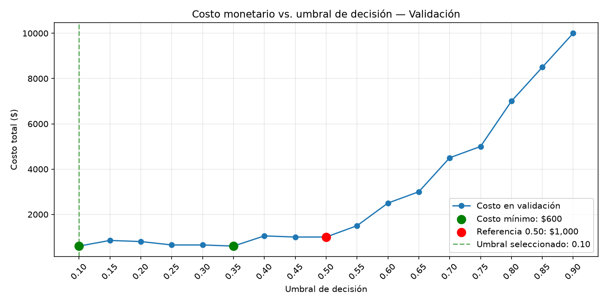

# Prácticas 1 y 2 — Machine Learning

## Descripción del proyecto

Este repositorio reúne el trabajo de las prácticas 1 y 2 de Machine Learning.

La Práctica 1 analiza lecturas de sensores de un robot Wall-Following:
explora y preprocesa los datos, entrena modelos supervisados y no
supervisados, compara su desempeño y mide la latencia de inferencia.

La Práctica 2 amplía ese trabajo con análisis de costos de clasificación,
selección de umbral, optimización de hiperparámetros con Optuna y
aprendizaje por refuerzo. Para la parte de RL se utiliza CartPole, un
entorno simulado independiente del dataset de sensores.

## Estructura del repositorio

```text
ml-practica1-pesantez/
├── config.json
├── data/
│   ├── raw/
│   └── processed/
│       └── dataset.parquet
├── models/
│   ├── random_forest.pkl
│   ├── svm.pkl
│   ├── kmeans.pkl
│   ├── dbscan.pkl
│   ├── p2_random_forest_final.joblib
│   └── ppo_cartpole.zip
├── notebooks/
│   ├── 01_eda.ipynb
│   ├── 02_supervised.ipynb
│   ├── 03_unsupervised.ipynb
│   ├── p2_01_metricas.ipynb
│   └── p2_06_gymnasium.ipynb
├── reports/
│   ├── figures/
│   │   ├── threshold_tuning.png
│   │   ├── optuna_historia.html
│   │   ├── optuna_importancias.html
│   │   └── ppo_cartpole_recompensas.html
│   ├── p2_04_optuna.db
│   ├── p2_04_mejor_resultado.json
│   ├── p2_05_comparacion.csv
│   ├── p2_09_evaluacion_rl.csv
│   ├── p2_09_evaluacion_rl.md
│   ├── p2_10_comparacion.csv
│   └── p2_10_comparacion.md
├── src/
│   ├── data_loader.py
│   ├── train_supervised.py
│   ├── train_unsupervised.py
│   ├── p2_02_costos.py
│   ├── p2_03_threshold.py
│   ├── p2_04_optuna.py
│   ├── p2_05_optuna_analisis.py
│   ├── p2_07_entorno_rl.py
│   ├── p2_08_entrenamiento_rl.py
│   ├── p2_09_evaluacion_rl.py
│   └── p2_10_comparacion.py
├── benchmark_latency.json
├── requirements.txt
└── README.md
```

La carpeta `reports/rl_monitor/` se crea al ejecutar el entrenamiento PPO y
contiene los registros de recompensas por episodio.

## Instalación y ejecución

### 1. Crear y activar el entorno virtual

```bash
python -m venv venv
```

### 2. Activar el entorno virtual

En Windows PowerShell:

```powershell
.\venv\Scripts\Activate.ps1
```

### 3. Instalar las dependencias

```bash
pip install -r requirements.txt
```

### 4. Ejecutar el modelo supervisado

Desde la carpeta raíz del proyecto:

```bash
python src/train_supervised.py
```

Este script:

- Carga el dataset original.
- Separa las variables de entrada y la variable objetivo.
- Divide los datos en entrenamiento y prueba.
- Aplica `RobustScaler`.
- Entrena un modelo Random Forest.
- Entrena un modelo SVM.
- Calcula Accuracy, F1-score y matriz de confusión.
- Compara el tiempo de entrenamiento de ambos modelos.
- Guarda los modelos entrenados en la carpeta `models/`.

### 5. Ejecutar los modelos no supervisados

```bash
python src/train_unsupervised.py
```

Este script:

- Carga los datos procesados.
- Utiliza las 24 variables de los sensores.
- Determina el número de clusters para K-Means mediante el método del codo.
- Entrena K-Means.
- Evalúa el agrupamiento mediante Silhouette Score.
- Entrena DBSCAN.
- Prueba diferentes valores de `eps`.
- Analiza el número de clusters y puntos considerados como ruido.
- Utiliza PCA para visualizar los clusters.
- Guarda los modelos entrenados en la carpeta `models/`.

### 6. Notebooks

La carpeta `notebooks/` contiene los análisis realizados durante la práctica:

- `01_eda.ipynb` — Exploración y análisis inicial de los datos.
- `02_supervised.ipynb` — Modelos de aprendizaje supervisado.
- `03_unsupervised.ipynb` — Modelos de aprendizaje no supervisado.

Los notebooks pueden abrirse directamente desde Visual Studio Code utilizando el entorno virtual del proyecto como kernel de Python.

## Resultados principales

### Aprendizaje supervisado

| Modelo | Accuracy | F1-score |
|---|---:|---:|
| Random Forest | 0.9954 | 0.9954 |
| SVM | 0.8690 | 0.8684 |

Random Forest obtuvo el mejor desempeño en la clasificación del conjunto de prueba.

### Aprendizaje no supervisado

| Modelo | Clusters | Ruido | Silhouette |
|---|---:|---:|---:|
| K-Means | 4 | 0 | 0.4702 |
| DBSCAN | 19 | 107 | 0.4052 |

Para K-Means se seleccionó `k = 4`.

Para DBSCAN se utilizó finalmente:

```text
eps = 5.0
min_samples = 5
```

### Estructura de resultados

Los modelos entrenados se almacenan en:

```text
models/
├── random_forest.pkl
├── svm.pkl
├── kmeans.pkl
└── dbscan.pkl
```

El benchmark de latencia se almacena en:

```text
benchmark_latency.json
```

## Tecnologías utilizadas

- Python 3.11
- Pandas
- NumPy
- Scikit-learn
- Matplotlib
- SciPy
- Joblib
- PyArrow
- Jupyter Notebook
- Gymnasium
- Stable-Baselines3
- Optuna
- Plotly

## Autor

Práctica 1 - Machine Learning

## Práctica 2 — Evaluación de factibilidad técnica y optimización

La Práctica 2 utiliza la clase `Slight-Left-Turn` como clase positiva y
las lecturas `US1` a `US24` como variables de entrada. Las primeras
sesiones estudian clasificación binaria y costos; las sesiones de RL
exploran CartPole como simulación separada del dataset original.

### Sesión 1: métricas de clasificación

Se cargó `data/processed/dataset.parquet`, se definió la clasificación
binaria, se mantuvo una partición estratificada y se entrenó un Random
Forest. Se calcularon accuracy, precision, recall, F1 y matriz de
confusión, y se comparó el resultado con un clasificador trivial que
siempre predice 0. El desarrollo está en `notebooks/p2_01_metricas.ipynb`.

## Práctica 2 — Sesión 2: Matriz de costos

### Objetivo
Comparar el costo de los errores de Random Forest con el de un
clasificador trivial que siempre predice 0.

### Clases y supuestos económicos
- Clase 1: giro leve a la izquierda (Slight-Left-Turn).
- Clase 0: todos los demás movimientos.
- Falso positivo (FP): predecir un giro leve a la izquierda cuando
  corresponde otro movimiento. Costo asignado: $50.
- Falso negativo (FN): no detectar un giro leve a la izquierda real.
  Costo asignado: $500.

Los valores son supuestos establecidos por la guía, no costos medidos
en un robot real. Representan un escenario en el que omitir un caso
positivo tiene un costo diez veces mayor que una falsa detección.

Los aciertos no añaden costo en la fórmula utilizada. No se incluyen
costos de entrenamiento, implementación ni mantenimiento.

### Cálculo
Costo total = FP × $50 + FN × $500

Ambos clasificadores se evaluaron sobre los mismos 1.092 registros
de prueba, conservando la partición utilizada en la sesión 1.

| Modelo | FP | FN | Costo total |
|---|---:|---:|---:|
| Random Forest | 1 | 3 | $1.550 |
| Siempre 0 | 0 | 66 | $33.000 |

Ahorro = $33.000 − $1.550 = $31.450.

### Conclusión
Random Forest reduce el costo de los errores en $31.450 respecto al
clasificador trivial, principalmente porque disminuye los falsos
negativos de 66 a 3. Este resultado corresponde únicamente al conjunto
de prueba y a los costos supuestos por la guía; no representa un
ahorro real medido ni una estimación anual.

### Ejecución
Desde la carpeta principal del proyecto, en PowerShell:

```powershell
.\venv\Scripts\python.exe .\src\p2_02_costos.py
```

## Práctica 2 — Sesión 3: Ajuste del umbral

### Procedimiento
Se obtuvieron probabilidades de la clase positiva (giro leve a la
izquierda) mediante predict_proba y se evaluaron 17 umbrales,
desde 0,10 hasta 0,90, con pasos de 0,05.

Se aplicó la regla: predecir 1 cuando la probabilidad sea mayor
o igual al umbral.

Como apoyo metodológico, la partición original de entrenamiento
se dividió de forma estratificada en 3.491 registros de entrenamiento
y 873 de validación. Los 1.092 registros de prueba se reservaron
para comprobar el umbral seleccionado.

### Selección en validación
Se utilizó la fórmula: costo = FP × $50 + FN × $500.

Los umbrales 0,10 y 0,35 empataron con el costo mínimo de $600.
Se seleccionó 0,10 mediante una regla de desempate previamente
definida: elegir el menor umbral. Esta regla es una decisión de
implementación, no un requisito de la guía.

Con 0,50 el costo fue $1.000; la reducción en validación fue $400.

### Comprobación en prueba
Se utilizó el mismo modelo entrenado, sin reajustar el umbral.

| Umbral | FP | FN | Costo |
|---|---:|---:|---:|
| 0,50 | 1 | 3 | $1.550 |
| 0,10 | 24 | 0 | $1.200 |

### Conclusión
El umbral 0,10 redujo el costo en prueba en $350 respecto a 0,50.
Aunque aumentaron los falsos positivos, se eliminaron los tres
falsos negativos, cuyo costo individual es mayor.
Estos resultados corresponden a los datos evaluados y a los costos
supuestos por la guía; no garantizan el mismo ahorro en datos futuros.

### Gráfico


### Ejecución
Desde la carpeta principal del proyecto:

```powershell
.\venv\Scripts\python.exe .\src\p2_03_threshold.py
```

## Práctica 2 — Sesión 4: Optimización con Optuna

### Procedimiento
Se ejecutó un estudio de Optuna con 20 pruebas completadas para
maximizar el F1 de la clase positiva: Slight-Left-Turn.

Cada prueba entrenó un Random Forest con una configuración distinta
o repetida de hiperparámetros, utilizando 3491 registros de
entrenamiento y los mismos 873 registros de validación.

Se mantuvo un umbral de decisión de 0,50. El conjunto de prueba
no se utilizó durante la optimización.

### Espacio de búsqueda
- n_estimators: 50, 100, 150 o 200.
- max_depth: None, 5, 10, 15 o 20.
- min_samples_leaf: entre 1 y 4.

Estos rangos son decisiones de implementación.

### Mejor resultado
- Mejor trial: 0.
- F1 en validación: 0,980392.
- n_estimators: 100.
- max_depth: None, sin límite explícito.
- min_samples_leaf: 1.
- random_state del modelo: 42.

### Conclusión
El trial 0 obtuvo el mayor F1 observado entre las configuraciones
evaluadas. Las pruebas posteriores no superaron ese resultado.

La configuración seleccionada coincide con la utilizada en la
sesión 3; por tanto, no se observó una mejora frente a esa
configuración bajo la misma validación y el umbral de 0,50.

El resultado no garantiza que sea la mejor configuración posible
ni representa una evaluación final sobre el conjunto de prueba.

### Archivos
- src/p2_04_optuna.py: código del estudio.
- reports/p2_04_optuna.db: estudio y registro de las pruebas.
- reports/p2_04_mejor_resultado.json: resumen del mejor resultado.

El estudio y el JSON no contienen un modelo entrenado exportado.

### Ejecución
Desde la carpeta principal del proyecto:

    .\venv\Scripts\python.exe .\src\p2_04_optuna.py

Al ejecutar nuevamente, el script carga el estudio existente y,
si ya tiene 20 pruebas completadas, no añade nuevas pruebas.


## Práctica 2 — Sesión 5: Análisis e interpretación de Optuna

### Análisis del estudio
Se cargó el estudio de la sesión 4, con 20 pruebas completadas.
El mejor F1 en validación fue 0,980392, alcanzado inicialmente
por el trial 0 y empatado por otras pruebas.

Se generaron los gráficos de historia de optimización e importancia
de hiperparámetros. La historia muestra que ninguna prueba posterior
superó el resultado inicial.

Con el evaluador fANOVA y semilla 42, las importancias aproximadas
fueron:
- min_samples_leaf: 0,48.
- max_depth: 0,43.
- n_estimators: 0,10.

Son estimaciones relativas a las pruebas y rangos evaluados.
No indican que aumentar un hiperparámetro mejore el modelo.
Los valores mostrados suman 1,01 por el redondeo.

### Configuración y entrenamiento final
Se exportó config.json con las variables, la clase positiva,
los hiperparámetros y la regla de decisión.

Configuración seleccionada:
- n_estimators: 100.
- max_depth: None.
- min_samples_leaf: 1.
- random_state: 42.
- Umbral: 0,50; se predice 1 cuando probabilidad >= umbral.

Como decisión metodológica, el modelo final se entrenó con los
4364 registros de la partición original train, incluidos los
873 utilizados anteriormente para validación.
Los 1092 registros de prueba quedaron fuera del entrenamiento.

Se guardó el modelo junto con su configuración de inferencia en
models/p2_random_forest_final.joblib.

### Comparación en prueba
Se reprodujo el Random Forest original y se evaluaron ambos modelos
con los mismos datos de prueba y la misma regla de umbral.

La comparación usa probabilidad >= 0,50 para ambos modelos;
el script de la sesión 2 utilizaba predict().

| Métrica | Original | Seleccionado por Optuna |
|---|---:|---:|
| Accuracy | 0,9963 | 0,9963 |
| Precisión | 0,9844 | 0,9844 |
| Recall | 0,9545 | 0,9545 |
| F1 | 0,9692 | 0,9692 |
| TN | 1025 | 1025 |
| FP | 1 | 1 |
| FN | 3 | 3 |
| TP | 63 | 63 |
| Costo ($) | 1550 | 1550 |

Costo = FP × $50 + FN × $500.

### Conclusión
No se observó una mejora respecto al modelo original.
La configuración seleccionada coincide con la original y ambos
modelos produjeron exactamente las mismas predicciones en prueba.

El F1 de selección en validación fue 0,9804; el F1 del modelo
reentrenado en prueba fue 0,9692. Corresponden a evaluaciones distintas.

No se reajustaron los hiperparámetros ni el umbral con los resultados
de prueba. Los resultados no garantizan el mismo desempeño futuro.

### Archivos
- src/p2_05_optuna_analisis.py
- config.json
- reports/figures/optuna_historia.html
- reports/figures/optuna_importancias.html
- models/p2_random_forest_final.joblib
- reports/p2_05_comparacion.csv

Los gráficos HTML se descargan y abren en un navegador.

### Ejecución
Desde la carpeta principal del proyecto:

    .\venv\Scripts\python.exe .\src\p2_05_optuna_analisis.py


## Práctica 2 — Sesión 6: Exploración de CartPole

Se exploró `CartPole-v1` de Gymnasium y su ciclo de interacción: observar
el estado, escoger una acción y recibir una recompensa. Se ejecutaron
cinco episodios con acciones aleatorias; sus recompensas totales fueron
20, 12, 31, 31 y 21, con un promedio de 23. El notebook es
`notebooks/p2_06_gymnasium.ipynb`. Para abrir el entorno visual, instala
`gymnasium[classic-control]` mediante `requirements.txt`.

## Práctica 2 — Sesión 7: Entorno de RL personalizado

Se creó `src/p2_07_entorno_rl.py`, un entorno lineal de cinco posiciones.
El agente comienza en la posición 0 y busca llegar a la meta, ubicada
en la posición 4.

- Observaciones: posición actual del agente (0 a 4).
- Acciones: 0 = izquierda; 1 = derecha.
- Recompensa: −1 por cada movimiento y +10 al alcanzar la meta.
- Finalización: el episodio termina al llegar a la meta o se trunca
  al alcanzar diez pasos.
- Representación: `A` indica al agente y `G` la meta.

Se probaron cinco episodios con acciones aleatorias. Los resultados
varían porque el agente no aprende de un episodio a otro.

### Ejecución

    .\venv\Scripts\python.exe .\src\p2_07_entorno_rl.py

    Resultados de los cinco episodios:
| Episodio | Resultado | Recompensa |
|---:|---|---:|
| 1 | Llegó a la meta | 3 |
| 2 | Límite de pasos | -10 |
| 3 | Límite de pasos | -10 |
| 4 | Llegó a la meta | 5 |
| 5 | Límite de pasos | -10 |

La recompensa promedio fue -4,4. Las acciones aleatorias no garantizan
que el agente alcance la meta.

## Práctica 2 — Sesión 8: Entrenamiento de PPO

Se entrenó un agente PPO en CartPole con un presupuesto solicitado de
10.000 pasos. Stable-Baselines3 completó 10.240 interacciones porque
PPO recopila experiencias en bloques. El promedio de recompensa de los
últimos diez episodios de entrenamiento fue 99,2.

- Script: `src/p2_08_entrenamiento_rl.py`.
- Modelo: `models/ppo_cartpole.zip`.
- Curva de recompensas: `reports/figures/ppo_cartpole_recompensas.html`.

## Práctica 2 — Sesión 9: Evaluación de PPO

Se evaluó el modelo durante diez episodios y se comparó con acciones
aleatorias. La tabla por episodio está en
`reports/p2_09_evaluacion_rl.csv`; el reporte se guarda en
`reports/p2_09_evaluacion_rl.md`.

| Agente | Recompensa mínima | Promedio | Recompensa máxima |
|---|---:|---:|---:|
| PPO | 249 | 395,90 | 500 |
| Acciones aleatorias | 14 | 21,90 | 43 |

En estos episodios, PPO superó al agente aleatorio por 374 puntos de
recompensa promedio.

## Práctica 2 — Sesión 10: Comparación con un controlador clásico

Se comparó PPO con un controlador basado en reglas que elige la acción
según el ángulo del péndulo. Ambos se evaluaron durante diez episodios.

| Método | Recompensa mínima | Promedio | Recompensa máxima |
|---|---:|---:|---:|
| PPO | 219 | 357,10 | 500 |
| Controlador basado en reglas | 34 | 48,00 | 58 |

En esta evaluación, PPO superó al controlador clásico por 309,10 puntos
de recompensa promedio. El controlador por reglas es sencillo y no
requiere entrenamiento, pero utiliza solo el ángulo; PPO requiere un
proceso de entrenamiento y aprovecha la observación completa. Las
sesiones 9 y 10 utilizaron distintas semillas; por eso sus promedios de
PPO corresponden a evaluaciones separadas.

### Ejecución de las sesiones de RL

Desde la carpeta principal del proyecto, con el entorno virtual activado:

```powershell
python .\src\p2_07_entorno_rl.py
python .\src\p2_08_entrenamiento_rl.py
python .\src\p2_09_evaluacion_rl.py
python .\src\p2_10_comparacion.py
```

Las sesiones 9 y 10 requieren que exista `models/ppo_cartpole.zip`,
creado en la sesión 8.
